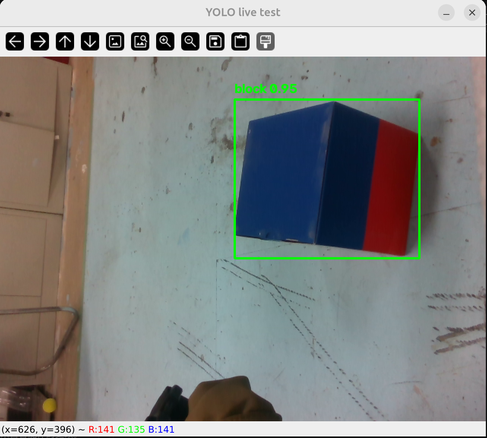

# Assignment3 — YOLO11n 比赛方块检测

使用 Ultralytics YOLO11n 训练一个**单类目标检测**模型，从 RealSense D435i 彩色图中检测红蓝双色比赛方块（类别 `block`），并输出边界框。

本版本为**完全重做**：使用新相机采集数据，并由**专业标注平台 CVAT** 人工标注，彻底解决上一版“框偏小 / 跨相机域偏移导致检测不准”的问题。

---

## 1. 环境依赖

```bash
pip install ultralytics opencv-python numpy pyrealsense2
```

- 训练 / 推理需 CUDA（本机 RTX 5070，`device=0`）
- 实时相机测试需连接 RealSense D435i（彩色流即可，不依赖深度）

---

## 2. 数据采集（`src/capture_blocks.py`）

用实际用于测试的相机拍图（**训练与测试必须同相机，否则有域偏移**）：

```bash
python3 src/capture_blocks.py
```

- 空格 / `s` 保存一组（彩色 png + 深度 npy + 内参 json），`q` 退出
- 本次使用**新购入的 D435i**（非旧设备），共采集 184 组

---

## 3. 数据标注（CVAT，专业标注平台）

不使用自动/脚本标注，改用 **[CVAT](https://cvat.ai)** 专业标注工具人工拖框：

1. CVAT 建任务，标签仅 `block` 一个
2. 上传全部 `*_color.png`，逐张用 **Rectangle / Shape** 拖框框住**整个方块**（红面 + 蓝面都进框，框线贴边缘）
3. 导出格式选 **YOLO 1.1**，得到每张图的 `.txt` 标注

标注文件（YOLO 格式 `class_id cx cy w h`，归一化）最终与图片同名存放。
> 注意：CVAT 导出目录为 `obj_train_data/`，需将其中的 `*_color.txt` 复制到图片同级目录。

---

## 4. 数据集组织（`src/split_dataset.py`）

```bash
python3 src/split_dataset.py
```

- 读取 `captures/` 下有效标注（排除 10 张 CVAT 漏标的空标注），共 **174 张**有效样本
- 按 **8:1:1** 随机切分：`train 139 / val 17 / test 18`
- 生成 `dataset_detect/`（`images/`、`labels/` 各含 train/val/test 子目录）+ `data.yaml`（`nc=1, names=['block']`）

---

## 5. 训练（`src/train_detect.py`）

```bash
python3 src/train_detect.py
```

- 预训练权重：`yolo11n.pt`
- 配置：`epochs=200, imgsz=640, batch=16, patience=50`
- 实际 **104 epoch 早停**（best @ epoch 54），权重：`runs/detect/block_yolo11n/weights/best.pt`

### 精度指标

| 集合 | Precision | Recall | mAP@0.5 | mAP@0.5:0.95 |
|------|-----------|--------|---------|--------------|
| val (17张) | 0.997 | 1.000 | 0.995 | 0.995 |
| test (18张, 独立) | — | 漏检 0 | IoU(推理/标注) 中位 **0.961**，最小 **0.906** | — |

test 集以“推理框 vs 人工标注框”的 IoU 验证，中位 0.961、零漏检，表明模型框的位置与大小都贴合人工标注（无偏小 / 无偏移）。

---

## 6. 推理

### 单张 / 目录图片测试（`src/predict_detect.py`）

```bash
python3 src/predict_detect.py --source <图片或目录> --weights weights/best.pt
```

### 实时相机测试（`src/camera_test_yolo.py`）

```bash
python3 src/camera_test_yolo.py --sn 043322075459   # 指定相机序列号（训练所用的那台）
python3 src/camera_test_yolo.py --cam 0             # 普通 USB / 笔记本摄像头
```

实时画面中每个被检出的方块显示绿框 + `block 0.xx`（类别与置信度）；`q` 退出，`空格` 保存当前帧。

推理使用 `imgsz=960`、`conf=0.15`：训练数据里方块在画面中普遍偏大（标注框宽度中位占图宽 32%），远距小方块在默认 640 下仅几十像素、轮廓糊掉会漏检，提高推理分辨率后实测可救回（见第 8 节）。

> ⚠ **必须与采集时保持相同的相机与色彩配置。** 本脚本以 `rs.format.bgr8` 请求彩色流，并**显式传入 `pipe.start(cfg)`**。早期版本漏传 `cfg`，libRealsense 按默认 `rgb8` 返回数据，导致红蓝互换 + 检测域偏移（完整定位过程见第 8 节）。

---

## 7. 结果示例

检测结果示例见 `results/result.jpg`（test 集中 IoU 最高的一帧，绿框紧贴方块边界）。

### 真机现场检验（`results/live_verify.png`）

修复第 8 节所述的现场色彩 Bug 后，用训练所用相机（SN `043322075459`）实时检测：



| 检验项 | 结果 |
|---|---|
| 置信度 | **0.95** |
| 框完整性 | 绿框完整包住方块，红面 + 蓝面均进框、贴边缘 |
| 颜色还原 | 蓝面为蓝、红面为红（修复前红蓝被互换） |

---

## 8. 真机调试记录：`pipe.start()` 漏传 `cfg` 引发的两类现象

真机测试时出现两个**看似无关**的异常，最终定位到**同一个根因**。

**现象**

1. 实时窗口中颜色互换：红箱显示成蓝、蓝箱显示成红
2. 检测时好时坏：近处能框住，换视角 / 拉远就 `no detection`——而 val/test 指标很好（mAP@0.5 = 0.995）

**定位过程**

用手机拍摄实物红箱 / 蓝箱作为"真相基准"，与相机保存的帧做**像素级**对照（只统计高饱和像素，排除背景木地板）：

| 目标 | 📱 手机实拍（基准） | 💾 相机保存的帧 | 判定 |
|---|---|---|---|
| 红箱 | R210 G38 B36 → 红 | R21 G37 B175 → 蓝 | **通道互换** |
| 蓝箱 | R67 G73 B157 → 蓝 | R121 G79 B42 → 红 | **通道互换** |

证明 R/B 在**数据层**即被调换。再对两种启动写法做实测：

```
pipe.start()      → 实际 rgb8   ← cfg 被忽略，红蓝互换
pipe.start(cfg)   → 实际 bgr8   ← 正确
```

**根因**：代码里 `cfg.enable_stream(..., rs.format.bgr8, 30)` 请求了 BGR，但 `pipe.start()` 未接收 `cfg`，libRealsense 按默认 **RGB8** 返回；而 OpenCV 显示 / 训练数据均按 BGR 解释：

```
数据层 R↔B 互换  →  ① 显示颜色反
                 →  ② 训练吃 BGR、推理吃 RGB = 额外域偏移 → 检测不稳
```

**修复**：改为 `pipe.start(cfg)`（一处）。经核查 `capture_blocks.py`、`block_pose.py` 本就正确，仅 `camera_test_yolo.py` 有此问题。修复后 `block 0.95`、框完整贴合、颜色正确（见 `results/live_verify.png`）。

**经验**：采集 → 训练 → 推理 → 显示任一环节的色彩空间假设不一致，都会以"验证集指标很好、真机却不准"的形式显现。真机异常必须回到像素级对照定位，不能只信指标。

---

## 9. 目录结构

```
Assignment3_YOLO/
├── README.md
├── src/
│   ├── capture_blocks.py   # 数据采集（D435i）
│   ├── label_detect.py     # 备选：本地标注脚本（本次用 CVAT，未使用）
│   ├── split_dataset.py    # 8:1:1 切分 + data.yaml
│   ├── train_detect.py     # 训练
│   ├── predict_detect.py   # 图片推理
│   ├── camera_test_yolo.py # 实时相机检测
│   ├── gen_and_eval.py     # test 集 IoU 验证 + 生成 result.jpg
│   └── block_pose.py       # 任务一：基于深度+YOLO掩码估计方块位姿
├── dataset_detect/         # 174 张训练数据（images/labels + data.yaml）
├── weights/
│   └── best.pt             # 训练得到的最佳权重
└── results/
    ├── result.jpg          # test 集检测效果示例
    └── live_verify.png     # 真机现场检验（修复色彩 Bug 后，block 0.95）
```

---

## 10. 备注

- **为什么重做**：上一版用旧 D435i 采集 + 自动/脚本标注，存在（a）标注框偏小（仅框住方块约 28%）；（b）换另一台相机测试出现域偏移导致框不准、色彩偏差。本次改用**新相机同域采集 + CVAT 专业人工标注**，从根本上修正。
- **已知局限**：训练数据中方块尺度偏单一（174 个标注框中宽度 <120px 的仅 1 个），远距小方块属于分布外样本。已通过提高推理分辨率至 `imgsz=960` 缓解（实测漏检帧可救回，置信度 0.78~0.86）；若要彻底覆盖，应补采一批远距小方块样本后重训。
- **位姿任务**：`block_pose.py` 结合本检测掩码与深度图估计方块 3D 位姿；现场相机 SN `043322075459` 已有对应内参标定（`calib_cam1.npz`），**无需重新标定**。另支持 `--offline <目录>` 离线跑通整条位姿链路（不连相机、无需显示器），已在采集数据上验证输出物理量合理。
