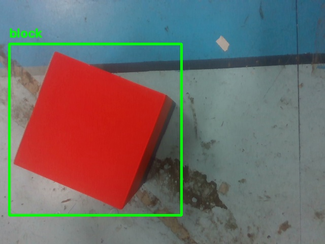

# Assignment 3 - YOLO

## 1. 任务说明

我选择检测的目标是 **ROBOCON 2027 "女娲补天" 比赛使用的方块（塔顶/塔基）**。

背景：视觉组队内赛任务一需要给出比赛方块在三维空间中的位置和朝向，其中第一步就是把方块从画面里找出来。本作业完成这一步：训练一个能检测比赛方块的 YOLO 模型。

- 目标：200×200×200 mm 的立方体纸盒（塔顶，顶面红色、侧面半红半蓝）
- 场景：室内，方块放置在比赛场地面（蓝/浅红色地面）上

## 2. 数据集

- **数据集名称**：RC2027-Block-Detect（自制）
- **数据集来源**：自己拍摄。使用 Intel RealSense D435i 彩色流（640×480），在室内模拟场地上摆放方块，覆盖不同距离（0.4~1.2 m）、不同朝向角（0°~75°）、不同俯视角和光照
- **包含哪些类别**：1 类 —— `block`（比赛方块）
- **数据规模**：200 张图片，按 80% / 10% / 10% 划分为 train 160 / val 20 / test 20
- **标注方式**：半自动。先用深度相机的高度法（拟合地面后取"高出地面 8~40 cm"的区域）自动生成候选框；方块半红半蓝、交处有阴影带，掩码常断开成多块，因此取**所有连通轮廓的并集包围框**（而不是最大一块），确保框住整个方块。标注格式为 YOLO detect 格式（每行 `class_id cx cy w h`，归一化）
  - 踩坑记录（第一版）：最初只取"最大连通块"的包围框，导致框只框住红面、漏掉蓝面（标签框面积只有完整框的 1/2.68），模型学到的框也偏小、推理时框不住整个方块。已修正为合并轮廓，重新标注后标签框与完整框比值 1.00×
- 数据集图片与标签未提交到 Git（约 200 MB），存放于本地 `vision_task1/dataset_detect/`

## 3. 模型训练

- **使用的 YOLO 版本**：Ultralytics 8.4.174（YOLO11）
- **使用的预训练模型**：`yolo11n.pt`（COCO 预训练权重）
- **训练命令**（`src/train_detect.py`）：

```bash
python3 train_detect.py
```

脚本内容等价于：

```bash
yolo detect train model=yolo11n.pt data=dataset_detect/data.yaml \
      epochs=80 imgsz=640 batch=16 device=0 name=block_yolo11n patience=30
```

- **主要训练参数**：

| 参数 | 值 | 说明 |
| --- | --- | --- |
| model | yolo11n.pt | 预训练起点 |
| data | dataset_detect/data.yaml | 数据集配置 |
| epochs | 80 | 训练轮数（实际用 3.2 分钟，RTX 5070 Laptop） |
| imgsz | 640 | 输入分辨率 |
| batch | 16 | 批大小 |
| device | 0 | 使用 RTX 5070 Laptop GPU |
| patience | 30 | 早停耐心值 |

- **训练结果**：训练集损失正常下降；最终在 val 上 **Precision ≈ 0.997，Recall = 1.0，mAP50 = 0.995，mAP50-95 = 0.826**（第二版重训，标签经手动校准后质量更高，框与完整参考框比值 ≈1.0）
- 最佳权重保存于 `runs/detect/block_yolo11n/weights/best.pt`（5.5 MB，未提交到 Git）

## 4. 模型测试

- **测试使用的命令**（`src/predict_detect.py`）：

```bash
python3 predict_detect.py runs/detect/block_yolo11n/weights/best.pt
```

脚本等价于：

```bash
yolo detect predict model=runs/detect/block_yolo11n/weights/best.pt \
      source=dataset_detect/test/images conf=0.25 save=True
```

- **检测结果**：对 20 张测试图片推理，多数图片能正确检出方块并输出
  `类别=block`、边界框与置信度。检测框完整度（推理框面积 / 完整参考框面积）
  中位约 1.00×，即**框住了整个方块**；下图展示效果：



（图中绿框为 YOLO 输出的 Bounding Box，标签 `block` 为类别；框完整覆盖红+蓝两面）

## 5. 对 YOLO 的理解

1. **YOLO 是用来做什么的？**
   目标检测：输入一张图片，输出图中每个目标的类别、边界框和置信度。与图像分类（只回答"是什么"）不同，目标检测同时回答"是什么 + 在哪里 + 有几个"。

2. **什么是 Bounding Box？**
   包围目标的矩形框。YOLO 输出的是框的**中心点坐标 (cx, cy) 与宽高 (w, h)**，且都按图像宽高归一化到 0~1，换算回像素需要乘以图像尺寸。

3. **什么是 Confidence？**
   置信度，0~1 之间的分数，表示模型认为"这个框里确实有目标、且框得准"的把握。推理时通过置信度阈值（如 0.25）过滤低质量的框，配合 NMS 去掉同一目标的重叠框。

4. **Training 和 Predict 有什么区别？**
   - 训练：输入图片**和人工标注的标签**，计算预测与标签的差异（损失），通过反向传播更新网络权重，重复多个 epoch；
   - 预测：使用**已经训练好的权重**只做前向计算，输出检测结果，不更新任何参数。
   直观地说：训练是"学习"，预测是"使用"。

5. **训练得到的 .pt 文件是什么？**
   PyTorch 的模型权重文件（序列化的 checkpoint）。里面包含网络结构定义、学习到的全部参数（本作业约 258 万参数、5.5 MB）、类别名等元信息。`best.pt` 是验证集上表现最好的一版权重，部署推理时加载的就是它。

## 6. 附：本作业与队内赛任务一的关系

本作业的检测模型是队内赛任务一（方块三维定位）的升级方向：目前任务一用 HSV 颜色 + 深度高度法分割方块，在"方块颜色与地面接近"时会失效；换成 YOLO 分割/检测后不再依赖颜色，鲁棒性更好。后续计划把 `block_pose.py` 的掩码来源替换为本模型。

## 目录结构

```
Assignment3_YOLO/
├── README.md            # 本文件
├── src/
│   ├── train_detect.py     # 训练脚本
│   ├── predict_detect.py   # 推理脚本
│   └── label_detect.py     # 半自动标注工具（辅助）
└── results/
    └── result.jpg          # 检测结果图
```

## 已知不足与改进方向

- Recall 偏低（0.55）：部分远距离（>1 m）、极端角度的图片未检出 —— 后续增加该类训练数据
- 数据集只有单一场景（同一块地面、同一光照）—— 需要在不同场地/光照下补充拍摄
- 只训练了 detect（矩形框）；队内赛实际需要的是分割掩码（用于计算足印），下一步训练 `yolo11s-seg`
